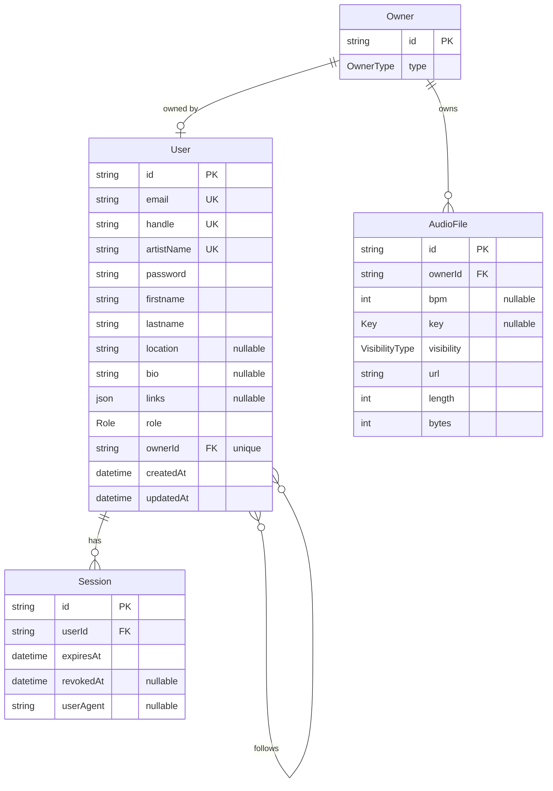

_This project has been created as part of the 42 curriculum by `<login1>`, `<login2>`, `<login3>`, ..._

# MakeSomeNoise

A collaborative, browser-based music production platform — the 42 `ft_transcendence` project.

## Table of Contents

- [Description](#description)
- [Team Information](#team-information)
- [Project Management](#project-management)
- [Technical Stack](#technical-stack)
- [Database Schema](#database-schema)
- [Instructions](#instructions)
- [Features List](#features-list)
- [Modules](#modules)
- [Individual Contributions](#individual-contributions)
- [Resources](#resources)
- [License](#license)

---

## Description

**MakeSomeNoise** is a music production platform that runs entirely in the browser.
Producers can create music in a web-based DAW, manage their sessions and audio samples,
follow other producers, and chat.

The platform is organized around three creative tools:

- **Studio** — a web DAW built on the [openDAW](https://opendaw.studio/) SDK (load samples
  onto a timeline, arrange clips, transport controls, playback).
- **Recorder** — live sessions and podcasts.
- **Mixer** — mixing and mastering.

Around these tools, the platform provides authentication, a samples library, session
management, and a social layer (following producers).

**Key features at a glance:**

- Browser DAW with drag-and-drop sample placement and playback
- Audio sample library with per-file visibility (private / shared / public)
- User accounts, sessions, and a follow-based social graph
- Secured access to audio files (nginx `auth_request` delegated to the backend)
- HTTPS everywhere through a single reverse-proxy entry point

---

## Team Information

> **⚠️ TODO (team to fill in).** For each member listed in the first line of this README:
>
> | Member (login) | Name | Role(s)                         | Responsibilities |
> | -------------- | ---- | ------------------------------- | ---------------- |
> | `<login1>`     | …    | PO / PM / Tech Lead / Developer | …                |
> | `<login2>`     | …    | …                               | …                |
> | `<login3>`     | …    | …                               | …                |

---

## Project Management

> **⚠️ TODO (team to fill in).**
>
> - **Work organization:** how tasks were distributed, meeting cadence, workflow.
> - **Project management tools:** e.g. GitHub Issues / GitHub Projects / Trello.
> - **Communication channels:** e.g. Discord / Slack.

---

## Technical Stack

| Layer                              | Technology                                                                                          |
| ---------------------------------- | --------------------------------------------------------------------------------------------------- |
| **Frontend**                       | React 19 + TypeScript, Vite, SASS modules, Ant Design, React Router                                 |
| **Audio engine (studio)**          | [`@opendaw/*`](https://github.com/andremichelle/openDAW-headless) SDK                               |
| **Backend**                        | Node.js, [Fastify](https://fastify.dev/) (`@fastify/jwt`, `@fastify/cookie`, `@fastify/rate-limit`) |
| **ORM / DB access**                | [Prisma](https://www.prisma.io/) (`@prisma/client`, `@prisma/adapter-pg`, `pg`)                     |
| **Database**                       | PostgreSQL 18                                                                                       |
| **Reverse proxy / static / audio** | nginx (TLS termination, static serving, `auth_request`)                                             |
| **Tooling**                        | pnpm workspace monorepo, Docker & Docker Compose, esbuild, Vite                                     |

**Justification for major technical choices:**

- **PostgreSQL** — the domain is strongly relational (users, owners, audio files, sessions,
  a many-to-many follow graph) and benefits from referential integrity and constraints.
  Audio binaries are kept on disk; only metadata lives in the database.
- **Prisma** — type-safe database access shared with the TypeScript codebase, plus a
  first-class migration workflow used both in development and at container startup.
- **Fastify** — lightweight, fast, plugin-based HTTP framework with official JWT/cookie/
  rate-limit plugins.
- **openDAW SDK** — provides the audio engine and project model so the studio can focus on
  core DAW interactions rather than rebuilding a synthesis/playback engine.
- **pnpm monorepo** — shared ESLint/Prettier config and a shared UI package across apps,
  with `workspace:*` linking.
- **Single nginx reverse proxy** — one public entry point, TLS terminated at the edge;
  everything behind it communicates over the internal Docker network (per the subject,
  internal traffic may be unencrypted).

---

## Database Schema

PostgreSQL, modeled with Prisma (`apps/back/prisma/schema.prisma`).



**Tables and relationships:**

- **Owner** — abstraction that owns audio files. `type` is `PLATEFORM` (shared/platform
  content) or `USER`. An owner optionally maps to a single `User` and to many `AudioFile`s.
- **User** — account (`email`, `handle`, `artistName` — all unique — hashed
  `password`, profile fields `firstname` / `lastname` / `location` / `bio` /
  `links`, `role` ∈ {`ADMIN`, `ARTIST`}). Linked one-to-one to an `Owner`. Self
  many-to-many relation `UserFollows` (`following` / `followedBy`). Has many `Session`s.
- **AudioFile** — sample/track metadata: optional `bpm` and `key`, `visibility`
  (`PRIVATE` / `SHARED` / `PUBLIC`), `url`, `length`, `bytes`. The binary file lives on disk.
- **Session** — authentication session for a user (`expiresAt`, optional `revokedAt`,
  `userAgent`); cascades on user deletion.

**Enums:** `Role`, `AudioType`, `Key`, `OwnerType`, `VisibilityType`.

---

## Instructions

### Prerequisites

- **Docker** and **Docker Compose**
- **Node.js 26** and **pnpm 11.1.3** (via `corepack` or `npm install -g pnpm@11.1.3`) — for local development
- **OpenSSL** — used by `pnpm prod` to generate the self-signed TLS certificate
- **Git**

### Environment configuration

The backend reads two environment files, both **git-ignored** — create them from the
provided example:

```sh
cp apps/back/.env.example      apps/back/.env        # development
cp apps/back/.env.prod.example apps/back/.env.prod   # production
```

Then set the values:

| Variable                                            | Notes                                                                                                                          |
| --------------------------------------------------- | ------------------------------------------------------------------------------------------------------------------------------ |
| `POSTGRES_USER`, `POSTGRES_PASSWORD`, `POSTGRES_DB` | Postgres credentials (used to initialize the DB container)                                                                     |
| `POSTGRES_URL`                                      | Connection string. **Dev:** host `localhost`, database `transcendence_dev`. **Prod:** host `db`, database `transcendence_prod` |
| `JWT_SECRET`                                        | A strong random secret for signing JWTs                                                                                        |

> Two databases live in a single Postgres instance: `transcendence_dev` and
> `transcendence_prod` (created by `infra/postgres/init_databases.sql`). Each environment
> points at its own database through `POSTGRES_URL`.

### Run in production (one command)

```sh
pnpm prod
```

This generates the TLS certificate, builds all images, and starts every service under the
`prod` profile. The application is then served at **https://localhost:8443** (the reverse
proxy publishes `8443:443` and `8080:80`; `http://localhost:8080` redirects to HTTPS —
self-signed certificate, accept the browser warning). Database migrations and the
production seed run automatically on backend startup.

Teardown:

```sh
pnpm services:down    # stop containers (keeps data)
pnpm services:kill    # stop + remove volumes and network (wipes the database)
```

### Run in development

In dev, the infrastructure runs in containers while the apps run on the host with hot reload:

```sh
pnpm install
docker compose up -d                              # db (exposed on 5432) + nginx-audio

pnpm --filter @transcendence/back db:migrate      # apply migrations to transcendence_dev
pnpm --filter @transcendence/back db:seed         # dev fixtures

pnpm --filter @transcendence/back dev             # backend  -> http://localhost:8080
pnpm --filter @transcendence/front dev            # frontend -> http://localhost:5173
pnpm --filter @transcendence/studio dev           # studio
```

---

## Features List

> **⚠️ TODO (team to confirm status and owners).** Candidate features detected in the
> codebase — confirm what is actually implemented and who worked on each.
>
> | Feature                   | Description                                                  | Status | Owner(s) |
> | ------------------------- | ------------------------------------------------------------ | ------ | -------- |
> | Web DAW (studio)          | Drag-and-drop samples onto the timeline, transport, playback | …      | …        |
> | Samples library           | Browse and manage audio samples                              | …      | …        |
> | Authentication            | Accounts, JWT, sessions                                      | …      | …        |
> | Social graph              | Follow / followers                                           | …      | …        |
> | Audio file access control | nginx `auth_request` → backend ownership check               | …      | …        |
> | Recorder                  | Live sessions / podcasts                                     | …      | …        |
> | Mixer                     | Mixing / mastering                                           | …      | …        |

---

## Modules

> **⚠️ TODO (team to fill in).** List every chosen `ft_transcendence` module.
>
> | Module | Type                         | Points | Justification & implementation | Owner(s) |
> | ------ | ---------------------------- | ------ | ------------------------------ | -------- |
> | …      | Major (2 pts) / Minor (1 pt) | …      | …                              | …        |
>
> **Total: `<sum>` points** (Major = 2 pts, Minor = 1 pt).

---

## Individual Contributions

> **⚠️ TODO (team to fill in).** For each member: features/modules/components they
> implemented, and notable challenges faced and how they were overcome.

---

## Resources

**Project documentation (`docs/`):**

- [`monorepo.md`](docs/monorepo.md) — workspace layout, packages, pnpm commands
- [`infra.md`](docs/infra.md) — dev and prod Docker/nginx topology
- [`architecture/database.md`](docs/architecture/database.md) — Postgres, the two DBs, schema, env vars
- [`architecture/audio-file-storage.md`](docs/architecture/audio-file-storage.md) — audio storage & access control
- [`authentication.md`](docs/authentication.md) — JWT + session auth
- [`prisma.md`](docs/prisma.md) · [`formatting.md`](docs/formatting.md) · [`linting.md`](docs/linting.md) · [`rebase-before-pr.md`](docs/rebase-before-pr.md)

**External documentation & references:**

- [openDAW](https://opendaw.studio/) and [openDAW-headless SDK](https://github.com/andremichelle/openDAW-headless)
- [Fastify documentation](https://fastify.dev/docs/latest/)
- [Prisma documentation](https://www.prisma.io/docs)
- [PostgreSQL documentation](https://www.postgresql.org/docs/)
- [Docker](https://docs.docker.com/) and [Docker Compose](https://docs.docker.com/compose/)
- [nginx documentation](https://nginx.org/en/docs/) — in particular [`ngx_http_auth_request_module`](https://nginx.org/en/docs/http/ngx_http_auth_request_module.html) and [`alias`](https://nginx.org/en/docs/http/ngx_http_core_module.html#alias)
- [Vite](https://vite.dev/) · [React](https://react.dev/)

---

## License

> **⚠️ TODO:** specify a license (e.g. MIT) or state that the project is unlicensed.
