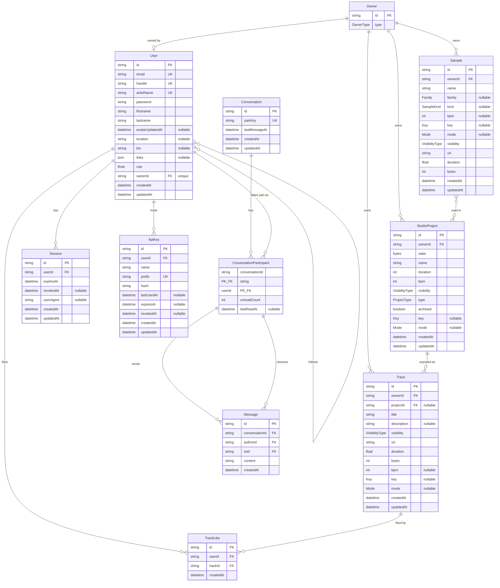

_This project has been created as part of the 42 curriculum by afaugero, anaudibe, jbayonne, lvilmain, mpelage._

# MakeSomeNoise

A collaborative, browser-based music production platform — the 42 `ft_transcendence` project.

## Table of Contents

- [Description](#description)
- [Team Information](#team-information)
- [Project Management](#project-management)
- [Technical Stack](#technical-stack)
- [Database Schema](#database-schema)
- [Instructions](#instructions)
- [Features List](#features-list)
- [Modules](#modules)
- [Individual Contributions](#individual-contributions)
- [Resources](#resources)

---

## Description

**MakeSomeNoise** is a music production platform that runs entirely in the browser.
Producers can create music in a web-based DAW, manage their sessions and audio samples,
follow other producers, and chat.

The platform is organized around three creative tools — a **Studio** (the DAW), a
**Recorder** (live sessions and podcasts) and a **Mixer** (mixing and mastering).
**Only the Studio is implemented**; the other two are part of the data model and the
navigation but were not built.

Around that tool, the platform provides authentication, a sample library, session and
track management, and a social layer: producers, following, presence and direct
messages.

**Key features at a glance:**

- A browser DAW: timeline, clips, transport, drag-and-drop samples, and an eleven-device
  effects rack, built on the [openDAW](https://opendaw.studio/) SDK
- Studio sessions that persist and reload, and export to a published `.wav` track
- A sample library with per-file visibility (private / shared / public), server-computed
  waveforms, and search with domain filters
- Accounts, revocable server-side sessions, four roles over an explicit permission table,
  and a back-office
- A social layer: producer profiles, follow graph, live presence, direct messages and
  likes — all multi-user and updated in real time over a single WebSocket
- Three fully translated locales (French, English, Spanish)
- Secured access to audio files (nginx `auth_request` delegated to the backend) and
  HTTPS everywhere through a single reverse-proxy entry point
- One-command deployment with Docker Compose

---

## Team Information

The team has five members. Every member is a Developer; the Product Owner, Project
Manager and Tech Lead roles are held in addition to that.

| Member (42 login) | Name                   | Role(s)                                           | Responsibilities                                                                                                                                                                                                                                                 |
| ----------------- | ---------------------- | ------------------------------------------------- | ---------------------------------------------------------------------------------------------------------------------------------------------------------------------------------------------------------------------------------------------------------------- |
| `afaugero`        | Alexis Faugeroux       | Tech Lead / Architect · Product Owner · Developer | Defines the architecture and the stack, owns the conventions written down in `docs/` and the `CLAUDE.md` files, reviews the critical changes; also owns the product vision, the backlog and the module selection. Works on infrastructure, backend and frontend. |
| `anaudibe`        | Antoine Audibert       | Developer                                         | Owns the producers vertical slice — the public producers API, the follow graph, likes — and the shared list contract (server-side search and pagination). Works on backend and frontend.                                                                         |
| `jbayonne`        | Julien Bayonne-Chenard | Developer                                         | Owns the real-time layer — WebSocket, presence, chat — and the save/load bridge between the studio and the backend. Works on backend and frontend.                                                                                                               |
| `lvilmain`        | Naëlle Vilmain         | PM / Scrum Master · Developer                     | Organizes the sprint planning and the team meetings, tracks progress and deadlines against the GitHub board, removes blockers and manages risks. Owns the roles and permissions system. Works on infrastructure and backend.                                     |
| `mpelage`         | Maya-Line Pelage       | Developer                                         | Owns the tracks vertical slice and the studio export path (offline render, export modal, project menu), plus the application shell header. Works on the frontend.                                                                                                |

**Role definitions used by the team** (as required by the subject):

- **Product Owner** — owns the product vision and the backlog, decides what ships,
  validates completed work, speaks for the project at evaluation.
- **Project Manager / Scrum Master** — organizes meetings and planning, tracks progress
  and deadlines, unblocks the team, manages risks.
- **Tech Lead / Architect** — defines the architecture, decides the stack, keeps the
  conventions in `docs/` and `CLAUDE.md` current, reviews the critical changes.
- **Developers** (everyone) — implement features and modules, review each other's pull
  requests, test their work and document it.

---

## Project Management

**Meetings**

A sprint planning every **Thursday at 10:00**: the previous sprint is closed, the GitHub
board is re-prioritized by the PO, and the issues of the coming sprint are assigned.
Blockers are raised on Discord between two plannings rather than kept until the next
meeting.

**Task distribution**

Work is split by **vertical slice**, not by layer: a member owning a feature owns it end
to end — Prisma model, backend route, frontend page and the three translations — which
keeps a change reviewable in a single pull request. Within that rule, each member has a
preferred area:

| Member     | Area                                |
| ---------- | ----------------------------------- |
| `afaugero` | Infrastructure · Backend · Frontend |
| `lvilmain` | Infrastructure · Backend            |
| `jbayonne` | Backend · Frontend                  |
| `anaudibe` | Backend · Frontend                  |
| `mpelage`  | Frontend                            |

The repository layout mirrors that split: each app carries its own conventions
(`apps/*/CLAUDE.md`) and every architectural decision is written down in `docs/` before
it is implemented, so a decision survives the conversation it was made in.

**Tools**

| Purpose           | Tool                                                                                                              |
| ----------------- | ----------------------------------------------------------------------------------------------------------------- |
| Task tracking     | GitHub Issues & GitHub Projects — commits reference their issue (`feat(front) #414 : …`)                          |
| Code review       | GitHub pull requests, rebased on `main` before merge (see [`docs/rebase-before-pr.md`](docs/rebase-before-pr.md)) |
| Communication     | Discord                                                                                                           |
| Code quality gate | `pnpm run check` — Prettier + ESLint + `tsc --noEmit` across the whole workspace                                  |

---

## Technical Stack

| Layer                              | Technology                                                                                          |
| ---------------------------------- | --------------------------------------------------------------------------------------------------- |
| **Frontend**                       | React 19 + TypeScript, Vite, SASS modules, Ant Design, React Router                                 |
| **Audio engine (studio)**          | [`@opendaw/*`](https://github.com/andremichelle/openDAW-headless) SDK                               |
| **Backend**                        | Node.js, [Fastify](https://fastify.dev/) (`@fastify/jwt`, `@fastify/cookie`, `@fastify/rate-limit`) |
| **ORM / DB access**                | [Prisma](https://www.prisma.io/) (`@prisma/client`, `@prisma/adapter-pg`, `pg`)                     |
| **Database**                       | PostgreSQL 18                                                                                       |
| **Reverse proxy / static / audio** | nginx (TLS termination, static serving, `auth_request`)                                             |
| **Tooling**                        | pnpm workspace monorepo, Docker & Docker Compose, esbuild, Vite                                     |

**Justification for major technical choices:**

- **PostgreSQL** — the domain is strongly relational (users, owners, samples, sessions,
  a many-to-many follow graph) and benefits from referential integrity and constraints.
  Audio binaries are kept on disk; only metadata lives in the database.
- **Prisma** — type-safe database access shared with the TypeScript codebase, plus a
  first-class migration workflow used both in development and at container startup.
- **Fastify** — lightweight, fast, plugin-based HTTP framework with official JWT/cookie/
  rate-limit plugins.
- **openDAW SDK** — provides the audio engine and project model so the studio can focus on
  core DAW interactions rather than rebuilding a synthesis/playback engine.
- **pnpm monorepo** — shared ESLint/Prettier config and a shared UI package across apps,
  with `workspace:*` linking.
- **Single nginx reverse proxy** — one public entry point, TLS terminated at the edge;
  everything behind it communicates over the internal Docker network (per the subject,
  internal traffic may be unencrypted).

---

## Database Schema

PostgreSQL, modeled with Prisma (`apps/back/prisma/schema.prisma`).



**Tables and relationships:**

- **Owner** — abstraction that owns the user-generated content: samples, tracks and
  studio projects. `type` is `PLATEFORM` (shared/platform content) or `USER`. An
  owner optionally maps to a single `User`.
- **User** — account (`email`, `handle`, `artistName` — all unique — hashed
  `password`, profile fields `firstname` / `lastname` / `location` / `bio` /
  `links`, `role` ∈ {`ADMIN`, `ARTIST`, `MODERATOR`, `GUEST`}). Linked one-to-one to
  an `Owner`. Self many-to-many relation `UserFollows` (`following` / `followedBy`).
  Has many `Session`s.
- **Sample** — sample metadata: `name`, optional `family` / `kind` /
  `bpm` / `key` / `mode`, `visibility` (`PRIVATE` / `SHARED` / `PUBLIC`), `url`,
  `duration` (ms) and `bytes` (both derived server-side from the file). The
  binary itself lives on disk. Many-to-many with `StudioProject`.
- **Track** — a rendered export of a project: `title`, optional `description`,
  `visibility`, `url`, `duration`, `bytes`, optional `bpm` / `key` / `mode`. Owned
  by an `Owner`; `projectId` is nullable with `onDelete: SetNull`, so deleting the
  session it came from does not delete the published audio.
- **StudioProject** — a studio session: serialized `state` (`Bytes`), `name`,
  `duration`, `bpm`, `visibility`, `type` (which creative tool), `archived`,
  optional `key` / `mode`. Owned by an `Owner`, references many `Sample`s (the
  samples it uses) and has many `Track`s.
- **Session** — authentication session for a user (`expiresAt`, optional `revokedAt`,
  `userAgent`); cascades on user deletion.
- **ApiKey** — a programmatic credential for a user: `name`, a unique `prefix` kept in
  clear, the `hash` of the key (sha256), optional `expiresAt`, `revokedAt` and
  `lastUsedAt`. Only the hash is stored — the key itself is shown once, at creation —
  and the prefix is what a request is resolved by. Cascades on user deletion.
- **TrackLike** — a user's like on a track, `@@unique([userId, trackId])` so a
  double-click or two parallel requests cannot insert two rows. Cascades when
  either the user or the track is deleted.
- **Conversation / ConversationParticipant / Message** — direct messaging.
  `Conversation.pairKey` is a unique canonical key for the pair of users, which
  makes a duplicate thread impossible even under a race.
  `ConversationParticipant` is the join row `(conversationId, userId)` and carries
  the per-user `unreadCount` / `lastReadAt`. `Message` references
  `ConversationParticipant` on both ends through composite foreign keys, so
  "the author belongs to this conversation" is enforced by the database.

**Enums:** `Role`, `Key`, `Mode`, `Family`, `OwnerType`, `VisibilityType`,
`SampleKind`, `ProjectType`.

---

## Instructions

### Prerequisites

- **Docker** and **Docker Compose**
- **Node.js 24** (pinned in `.nvmrc` — `nvm use` picks it up) and **pnpm 11.1.3**
  (declared in `devEngines.packageManager`, so `corepack` downloads it on first use)
  — for local development
- **Git**

### Environment configuration

The backend reads two environment files, both **git-ignored** — create them from the
provided example:

```sh
cp apps/back/.env.example      apps/back/.env        # development
cp apps/back/.env.prod.example apps/back/.env.prod   # production
```

Then set the values:

| Variable                                            | Notes                                                                                                                                                                                                                                                                                                                    |
| --------------------------------------------------- | ------------------------------------------------------------------------------------------------------------------------------------------------------------------------------------------------------------------------------------------------------------------------------------------------------------------------ |
| `POSTGRES_USER`, `POSTGRES_PASSWORD`, `POSTGRES_DB` | Postgres credentials (used to initialize the DB container)                                                                                                                                                                                                                                                               |
| `POSTGRES_URL`                                      | Connection string. **Dev:** host `localhost`, database `transcendence_dev`. **Prod:** host `db`, database `transcendence_prod`                                                                                                                                                                                           |
| `JWT_SECRET`                                        | A strong random secret for signing JWTs                                                                                                                                                                                                                                                                                  |
| `MEDIA_ROOT`                                        | Root holding uploaded media, one subdirectory per kind (`samples/`, `tracks/`, `avatars/`). **Dev:** `../../infra/media_data` — resolved relative to `apps/back`, so it must climb out of the app to reach the repo's `infra/media_data` that `nginx-media` mounts. **Prod:** `/var/www/media` (the `media_data` volume) |

`POSTGRES_URL` and `JWT_SECRET` are validated at boot — the backend refuses to
start without them rather than falling back to a default.

The two frontends read their own git-ignored env files:

```sh
cp apps/front/.env.example  apps/front/.env
cp apps/studio/.env.example apps/studio/.env
```

| Variable          | App    | Notes                                                                            |
| ----------------- | ------ | -------------------------------------------------------------------------------- |
| `VITE_STUDIO_URL` | front  | Where the "open the studio" links point (`http://localhost:5174/studio/` in dev) |
| `VITE_FRONT_URL`  | studio | Where the studio sends the user back on leaving (`http://localhost:5173` in dev) |

> Two databases live in a single Postgres instance: `transcendence_dev` and
> `transcendence_prod` (created by `infra/postgres/init_databases.sql`). Each environment
> points at its own database through `POSTGRES_URL`.

### Run in production (one command)

```sh
pnpm prod
```

This builds all images and starts every service under the `prod` profile. The TLS
certificate is generated by the one-shot `reverse-proxy-seeder` container (OpenSSL
runs inside it, not on the host) into the `shared_certs` volume, and is reused on
later runs. The application is then served at **https://localhost:8443** — the
reverse proxy publishes `8443:443` only, and the certificate is self-signed, so
accept the browser warning. Database migrations and the production seed run
automatically on backend startup.

Teardown:

```sh
pnpm services:down    # stop containers (keeps data)
pnpm services:kill    # stop + remove volumes and network (wipes the database)
```

### Run in development

In dev, the infrastructure runs in containers while the apps run on the host with hot reload:

```sh
pnpm install
docker compose up -d                              # db (exposed on 5432) + nginx-media

pnpm --filter @transcendence/back db:migrate      # apply migrations to transcendence_dev
pnpm --filter @transcendence/back db:seed         # dev fixtures

pnpm --filter @transcendence/back dev             # backend  -> http://localhost:8080
pnpm --filter @transcendence/front dev            # frontend -> http://localhost:5173
pnpm --filter @transcendence/studio dev           # studio
```

---

## Features List

Owners are the members who carried each feature; see [Individual Contributions](#individual-contributions)
for the detailed breakdown.

### Accounts & access

| Feature                | Description                                                                                                                                                                                     | Owner(s)                |
| ---------------------- | ----------------------------------------------------------------------------------------------------------------------------------------------------------------------------------------------- | ----------------------- |
| Sign up / log in       | Email + password, passwords hashed and salted, inputs validated on both sides (JSON Schema server-side, form validation client-side)                                                            | `afaugero` · `lvilmain` |
| Server-side sessions   | Every login creates a `Session` row (`expiresAt`, `userAgent`); a JWT alone is not enough — a revoked session is rejected immediately                                                           | `lvilmain`              |
| Session management     | A user sees their active sessions and can revoke them; an admin can revoke every session of an account, which also closes its live sockets                                                      | `afaugero` · `jbayonne` |
| Roles & permissions    | Four roles (`GUEST`, `ARTIST`, `MODERATOR`, `ADMIN`) over one explicit permission table shared by the three apps; the same `can()` gates the server guard and the rendered UI                   | `lvilmain`              |
| Back-office (`/admin`) | User CRUD, role changes, session revocation, track moderation — route-guarded by permission, not by role                                                                                        | `afaugero`              |
| Profile                | Avatar upload, artist name, handle, bio, location, external links                                                                                                                               | `afaugero`              |
| API keys               | `X-API-Key` credentials created and revoked from `/settings`, stored hashed and shown once; a key carries exactly its owner's permissions, and the public API is documented at `/documentation` | `afaugero`              |

### Creation

| Feature             | Description                                                                                                                                                                                                    | Owner(s)               |
| ------------------- | -------------------------------------------------------------------------------------------------------------------------------------------------------------------------------------------------------------- | ---------------------- |
| Studio (web DAW)    | Timeline with tracks and clips, transport (play / stop / loop / BPM), drag-and-drop of samples onto the timeline, clip editor, peak meters — built on the openDAW SDK                                          | `afaugero`             |
| Effects rack        | Eleven devices (compressor, delay, two reverbs, bitcrusher, wavefolder, waveshaper, maximizer, noise gate, stereo tool, tremolo/autopan) with a per-device UI and a registry that maps SDK boxes to components | `afaugero`             |
| Session persistence | A studio session is serialized to `StudioProject.state` and reloaded as it was left; sessions can be renamed, archived and deleted                                                                             | `jbayonne` · `mpelage` |
| Track export        | A session is rendered to a `.wav` track with its own title, description, visibility and musical metadata                                                                                                       | `mpelage`              |
| Sample library      | Upload, browse, filter and delete samples; visibility is per file (`PRIVATE` / `SHARED` / `PUBLIC`)                                                                                                            | `afaugero`             |
| Waveform previews   | Each uploaded `.wav` gets a `.peaks` sidecar computed server-side, so the browser draws a waveform without downloading the audio                                                                               | `afaugero`             |

### Social & real-time

| Feature              | Description                                                                                                                      | Owner(s)               |
| -------------------- | -------------------------------------------------------------------------------------------------------------------------------- | ---------------------- |
| Producers directory  | Browse producers, open a public profile, see their published tracks                                                              | `anaudibe`             |
| Follow graph         | Follow / unfollow, followers and following lists                                                                                 | `anaudibe`             |
| Presence             | Online status of the producers you follow, pushed over the WebSocket with a heartbeat that detects dropped sockets               | `jbayonne`             |
| Direct messages      | One-to-one conversations with persisted history, per-user unread counts and read receipts; delivery is live over the same socket | `jbayonne`             |
| Unread notifications | A header bell listing conversations with unread messages, kept in sync in real time                                              | `mpelage` · `jbayonne` |
| Track likes          | Like / unlike a track and browse your liked tracks; `@@unique([userId, trackId])` makes a double submit a no-op                  | `anaudibe`             |

### Platform

| Feature                 | Description                                                                                                                                                 | Owner(s)                |
| ----------------------- | ----------------------------------------------------------------------------------------------------------------------------------------------------------- | ----------------------- |
| Internationalization    | Three complete locales (French, English, Spanish) with a language switcher; translation keys are type-checked at build time                                 | `afaugero` · `lvilmain` |
| Search, filters, paging | One shared `page` / `limit` / `q` contract across every list endpoint, plus domain filters on samples (BPM, key, mode, family, kind, visibility)            | `anaudibe` · `mpelage`  |
| Audio access control    | `/samples/` and `/tracks/` are served by nginx behind `auth_request`, which asks the backend whether this session may read this file; `/avatars/` is public | `jbayonne` · `afaugero` |
| HTTPS everywhere        | TLS terminated at the reverse proxy, the only published port; traffic between containers stays on the internal Docker network                               | `lvilmain` · `afaugero` |
| Rate limiting           | `@fastify/rate-limit` on the sensitive routes (auth, uploads, admin)                                                                                        | `anaudibe`              |
| Legal pages             | Terms of Service, Privacy Policy and Legal Notice, each written in the three locales and reachable from the footer                                          | `afaugero`              |
| One-command deployment  | `pnpm prod` builds every image and starts the whole stack, including TLS certificate generation, migrations and seeding                                     | `lvilmain` · `afaugero` |

**Planned but not implemented:** the **Recorder** (live sessions, podcasts) and the
**Mixer** (mixing/mastering) tools exist in the data model (`ProjectType`) and in the
navigation, but only the **Studio** is implemented. Collaborative real-time editing
inside the DAW was in the original plan and was not built.

---

## Modules

**14 points are required.** The team claims **7 Major (14 pts) + 7 Minor (7 pts) = 21
points**; the 7 points above the threshold are submitted as bonus (the subject caps the
bonus at 5 points).

| #   | Module                                          | Category             | Type  | Pts    | Owner(s)                |
| --- | ----------------------------------------------- | -------------------- | ----- | ------ | ----------------------- |
| 1   | Framework for both frontend and backend         | Web                  | Major | 2      | `jbayonne` · `afaugero` |
| 2   | Real-time features using WebSockets             | Web                  | Major | 2      | `jbayonne`              |
| 3   | Users interacting with other users              | Web                  | Major | 2      | `jbayonne` · `anaudibe` |
| 4   | Public API with API key, rate limiting and docs | Web                  | Major | 2      | `anaudibe` · `afaugero` |
| 5   | Standard user management and authentication     | User Management      | Major | 2      | `afaugero` · `anaudibe` |
| 6   | Advanced permissions system                     | User Management      | Major | 2      | `lvilmain` · `afaugero` |
| 7   | Audio processing pipeline (custom module)       | Modules of choice    | Major | 2      | `afaugero` · `mpelage`  |
| 8   | ORM for the database                            | Web                  | Minor | 1      | `jbayonne` · `afaugero` |
| 9   | Complete notification system                    | Web                  | Minor | 1      | `mpelage`               |
| 10  | Custom-made design system                       | Web                  | Minor | 1      | `afaugero`              |
| 11  | Advanced search: filters, sorting, pagination   | Web                  | Minor | 1      | `anaudibe` · `mpelage`  |
| 12  | File upload and management system               | Web                  | Minor | 1      | `afaugero` · `mpelage`  |
| 13  | Support for multiple languages (3+)             | Accessibility / i18n | Minor | 1      | `afaugero`              |
| 14  | Support for additional browsers                 | Accessibility / i18n | Minor | 1      | whole team              |
|     | **Total**                                       |                      |       | **21** |                         |

---

### 1. Framework for both frontend and backend — Major (2 pts)

**Frontend: React 19.** All three user-facing apps (`apps/front`, `apps/studio` and the
shared `packages/ui`) are React, with React Router for routing and TanStack Query for
server state.

**Backend: Fastify.** `apps/back` is a Fastify server: the plugin system carries
authentication (`app.authenticate`), authorization (`app.authorize`), rate limiting,
cookies and JWT; routing is split into nine prefixes documented in
[`docs/architecture/api.md`](docs/architecture/api.md).

**Why:** Fastify's JSON Schema validation is not a bolt-on — declaring a route's
`querystring`, `body` and `response` schemas validates the input, serializes the output
and documents the contract in one place, which is why every route in `apps/back/src/routes/`
is a schema next to a handler.

---

### 2. Real-time features using WebSockets — Major (2 pts)

One endpoint, `GET /api/ws` (`@fastify/websocket`), carries **presence** and **chat
delivery** under a `{ event, data }` envelope. Fully documented in
[`docs/architecture/realtime.md`](docs/architecture/realtime.md).

- **Real-time updates across clients** — a sent message reaches the recipient's open
  tabs without a refresh; going online or offline updates the status dot of everyone
  who follows you; a follow event reaches the followed user live.
- **Connection/disconnection handled gracefully** — the socket is authenticated by the
  same session cookie as the REST API (no second auth mechanism, no token in the query
  string), so it cannot open without a valid, non-revoked session. A heartbeat
  (`_alive` `WeakMap`) detects sockets that died without a close frame and reaps them;
  revoking an account's sessions calls `closeAll(userId)` and drops its live sockets
  instead of leaving them open until the next HTTP call.
- **Efficient broadcasting** — one in-memory registry (`Map<userId, Set<WebSocket>>`)
  answers both "is this user online" and "where do I deliver this message", so a
  broadcast is a lookup on the recipients rather than a scan of every connection.

**Why one socket instead of two:** presence and chat are unrelated features, but they
share the expensive thing — the registry of who is connected. Two endpoints would mean
maintaining the same map twice and keeping the two in agreement.

---

### 3. Allow users to interact with other users — Major (2 pts)

| Requirement                               | Implementation                                                                                                                                                      |
| ----------------------------------------- | ------------------------------------------------------------------------------------------------------------------------------------------------------------------- |
| Basic chat (send/receive between users)   | `/api/chat/*` + the `Messages` page. One-to-one conversations with persisted history, per-user unread counts and `lastReadAt`. Delivery is live over the WebSocket. |
| Profile system (view user information)    | `/producers` directory and `/producers/:handle` public profile — artist name, avatar, bio, location, links, published tracks, follower counts.                      |
| Friends system (add/remove, see the list) | Follow / unfollow through `/api/producers/*`, with `/following` and the followers list. Online status of followed producers is pushed in real time.                 |

**Data-model note.** `Conversation.pairKey` is a unique canonical key built from the
sorted pair of user ids, so two users opening a thread at the same instant cannot create
two conversations — the database rejects the second insert instead of the application
racing. `Message` references `ConversationParticipant` on both ends through composite
foreign keys, which makes "the author belongs to this conversation" a database
invariant rather than a check the code has to remember. See
[`docs/architecture/chat.md`](docs/architecture/chat.md).

---

### 4. Public API with a secured API key, rate limiting, documentation and 5+ endpoints — Major (2 pts)

| Requirement          | Implementation                                                                                                                  |
| -------------------- | ------------------------------------------------------------------------------------------------------------------------------- |
| Secured API key      | `X-API-Key` header, keys created and revoked from `/settings`, stored hashed. See below.                                        |
| Rate limiting        | `@fastify/rate-limit` per route family (`apps/back/src/constants.ts`), keyed on the API key so one key cannot throttle another. |
| Documentation        | OpenAPI 3.1 served at **`/documentation`**, generated from the route schemas.                                                   |
| At least 5 endpoints | 52 operations over 51 paths, all four verbs.                                                                                    |

**The key.** `msn_<prefix>_<secret>` — an 8-character prefix plus 256 bits of
randomness. Only `sha256(key)` is stored; the plaintext is shown once, at creation,
and cannot be read again. The prefix is stored in clear and is unique, so a request
is resolved by one indexed lookup followed by one `timingSafeEqual` on the digests —
not a scan of the table. A password KDF would be the wrong tool here: a key is 256
bits we generated ourselves, so slowing verification down buys nothing and costs
latency on every request.

**How it fits the existing auth.** The `onRequest` hook that reads the session falls
through to the header when there is no valid JWT, and attaches the same
`req.authUser`. Everything downstream — `app.authorize`, `can()`, the ownership
checks — is unchanged, so a key carries exactly its owner's permissions and nothing
more. Routes guarded by `authenticateSession` stay closed to keys: opening a
WebSocket, logging out, changing the password, deleting the account, and managing
keys. A leaked key cannot mint another one.

**The documentation is generated, not written.** Every route already declared JSON
Schemas for its querystring, body and responses (#371); `@fastify/swagger` turns
those into the spec, so the contract and its documentation cannot drift. What is
hand-written is the prose — a `summary`, a `description` and a tag per route, plus
the two security schemes (`sessionCookie` and `apiKey`).

| URL                   | What                                |
| --------------------- | ----------------------------------- |
| `/documentation`      | Swagger UI — browsable and callable |
| `/documentation/json` | the raw OpenAPI 3.1 document        |
| `/documentation/yaml` | the same, as YAML                   |

`pnpm --filter @transcendence/back run openapi` writes the spec to a file without
starting a server, which makes the API surface diffable in a review.

**Endpoints** — `GET /api/samples/get`, `POST /api/samples/upload`,
`PUT /api/samples/update?id=`, `DELETE /api/samples/delete?id=`, `GET /api/tracks/get`,
`POST /api/tracks/upload`, `PUT /api/admin/users/update`, `DELETE /api/user/delete`,
and 44 more; the map is in [`docs/architecture/api.md`](docs/architecture/api.md),
the reasoning in [`docs/authentication.md`](docs/authentication.md).

**Limits, assumed.** A key carries its owner's full permissions — there is no
per-key scope. 10 active keys per account, optional expiry of 30, 90 or 365 days.

---

### 5. Standard user management and authentication — Major (2 pts)

| Requirement                                   | Implementation                                                                                                           |
| --------------------------------------------- | ------------------------------------------------------------------------------------------------------------------------ |
| Users can update their profile information    | `/settings` — artist name, handle, first/last name, bio, location, external links.                                       |
| Avatar upload, with a default if none         | `POST /api/users/avatar`, stored under `avatars/` and served publicly by nginx; a generated default is shown when unset. |
| Add other users as friends, see online status | Follow graph plus live presence pushed over the WebSocket — the status dot on `StatusAvatar` is driven by the registry.  |
| Profile page displaying their information     | `/producers/:handle`, public, with the producer's published tracks.                                                      |

**Authentication.** Email + password; passwords are hashed and salted. A successful
login writes a `Session` row (`expiresAt`, `userAgent`, nullable `revokedAt`) and the
JWT alone is never sufficient — every authenticated request re-checks the session, so a
revoked session is rejected immediately instead of staying valid until the token
expires. Users can list and revoke their own sessions; an admin can revoke every session
of an account. See [`docs/authentication.md`](docs/authentication.md).

---

### 6. Advanced permissions system — Major (2 pts)

| Requirement                          | Implementation                                                                                                                 |
| ------------------------------------ | ------------------------------------------------------------------------------------------------------------------------------ |
| View, edit and delete users (CRUD)   | `/admin` back-office: paginated and searchable user list, role change, account deletion, session revocation, track moderation. |
| Roles management                     | Four roles — `GUEST`, `ARTIST`, `MODERATOR`, `ADMIN` — over **one explicit permission table**, not a role comparison.          |
| Different views and actions per role | The front and the studio render from the same `can()` the server guards with; `RequirePermission` gates whole routes.          |

**Why a permission table rather than role checks.** Scattering `if (user.role === 'ADMIN')`
across three apps means the answer to "who can do this" lives in dozens of places and
drifts. Here the ten permissions (`packages/permissions`) are declared once, the mapping
role → permissions is one object, and the three apps import the same `can()`. The server
guard `app.authorize(permission)` answers **403, never 401** — "you are authenticated
but not allowed" is a different failure from "you are not authenticated", and conflating
them makes the frontend retry a login that would not help. See
[`docs/architecture/permissions.md`](docs/architecture/permissions.md).

---

### 7. Audio processing pipeline — custom Major module (2 pts)

**Why we chose it.** The subject asks for a substantial module relevant to the project
context. MakeSomeNoise is a music platform, so the part that had to be built from
scratch was the one no library gave us: getting from an uploaded `.wav` to something a
browser can display and a DAW can play, without shipping megabytes of audio to draw a
few hundred pixels.

**What it contains.**

- **A WAV decoder written from the bytes up** (`apps/back/src/services/wav.ts`). It
  walks the RIFF chunk list and decodes PCM 8-, 16-, 24- and 32-bit as well as IEEE
  float 32- and 64-bit into normalized `Float32Array` channels. 24-bit is the awkward
  case — there is no `readInt24LE`, so the three bytes are assembled and sign-extended
  by hand. Unsupported combinations fail loudly rather than producing silence. The
  format is documented end to end in [`docs/wav.md`](docs/wav.md).
- **A custom binary sidecar format, `.peaks` / MSNP** (`apps/back/src/services/msnp.ts`,
  read by `apps/front/src/lib/peaks.ts`). An 8-byte header (`"MSNP"`, version, channels,
  bucket count) followed by `channels × buckets` min/max pairs of signed 8-bit values,
  channel-major, little-endian. No chunks, no variable-length fields: the whole file is
  addressable by arithmetic. Specified in [`docs/peaks.md`](docs/peaks.md).
- **Waveform rendering on the frontend** from that envelope, in the sample library, the
  track lists and the studio browser.
- **The DAW itself** (`apps/studio`) on top of the openDAW SDK: timeline and grid,
  clips, tracks, transport, peak meters, panel layout, and an eleven-device effects
  rack with a registry mapping SDK boxes to React components
  ([`docs/architecture/studio-devices.md`](docs/architecture/studio-devices.md)).

**The technical challenge it addresses.** Drawing a waveform needs an _envelope_, not
audio. Taking it from the `.wav` means downloading the whole file and running
`decodeAudioData` in the browser — for one real sample in our library, 1 012 356 bytes
of WAV against 4 104 bytes of peaks, about **250× smaller**, and already in the shape
the renderer wants. A hundred-sample library costs ~400 KB instead of ~100 MB. The
sidecar is computed once, server-side, at upload time, and stored next to the `.wav`
with the same UUID.

**Why it deserves Major status.** It is a binary format designed, specified and
implemented by the team, a decoder written against the RIFF specification rather than a
parsing library, and a browser renderer on the other end — three pieces that have to
agree byte for byte, plus the DAW that consumes them. It is not a wrapper around an npm
package, and it is what makes the library pages usable at all.

---

### 8. Use an ORM for the database — Minor (1 pt)

Prisma (`@prisma/client` with the `@prisma/adapter-pg` driver adapter) over PostgreSQL 18. The schema lives in `apps/back/prisma/schema.prisma`, migrations are versioned and
applied automatically at container startup, and the generated client gives the
TypeScript codebase end-to-end types from the database to the route response. All
database access is isolated in `apps/back/src/repositories/` — no Prisma call escapes
that layer.

---

### 9. Complete notification system for creation, update and deletion actions — Minor (1 pt)

Every mutation surfaces a result to the user rather than failing silently: sample upload
and deletion, session creation, renaming, archiving and deletion, track publication and
deletion, profile and account updates, admin role changes, session revocation and
account deletion. Unread direct messages are additionally surfaced in a header bell
(`NotificationsBell`) that is kept in sync in real time over the WebSocket, with a
per-conversation unread count read from `ConversationParticipant.unreadCount`.

---

### 10. Custom-made design system — Minor (1 pt)

The design system was extracted from openDAW's visual language into `design/` (a
read-only reference: `design/README.md`, `design/colors_and_type.css`,
`design/ui_kits/`) and translated into code in `packages/ui`.

- **Color palette and typography** — `packages/ui/styles/colors_and_type.css` holds the
  tokens; `packages/ui/theme/theme.ts` and `MsnThemeProvider` feed the same values to
  Ant Design so a component and a hand-written panel cannot drift apart. Rubik as the
  type family, near-black panels, saturated accent hues used as _functional_ state
  colors.
- **Icons** — one SVG sprite exposed through `MsnIcon` with a typed `MsnIconLabel`
  union, so an icon name that does not exist is a compile error.
- **Reusable components** — `MsnIcon`, `MsnKnob`, `MsnPill`, `MsnWordmark`, `IconBtn`,
  `Separator` (shared package), plus `MsnParamKnob`, `MsnParamSelect`, `MsnParamToggle`,
  `MsnParamGroup`, `MsnPeakMeter`, `StudioIcon`, `PanelFrame`, `PanelHeader` (studio)
  and `CoverArt`, `StatusAvatar`, `UserChip`, `Waveform`, `HeaderIconButton` (front).

---

### 11. Advanced search with filters, sorting and pagination — Minor (1 pt)

One contract shared by every list endpoint — `page`, `limit`, `q` returning
`{ items, total, page, limit }`, with the full list when both paging params are omitted
([`docs/pagination.md`](docs/pagination.md)) — plus domain filters on top.

- **Filters** — samples can be narrowed by BPM, key, mode, family, kind and visibility,
  each as a repeatable array parameter validated against the Prisma enums; tracks by
  visibility; users by role in the back-office. The sample and track toolbars expose
  them as multi-selects with a reset.
- **Search** — a debounced `q` sent to the server, across samples, tracks, producers and
  users. It is not a client-side filter on an already-loaded list: the query goes to
  Postgres.
- **Sorting** — user-controlled from the toolbars: samples by recent, name, duration,
  size or BPM (`SAMPLE_COMPARATORS`), tracks by the equivalent set
  (`TRACK_COMPARATORS`). Lists also carry a sensible server-side default (`createdAt desc`
  for samples and tracks, `artistName asc` for producers, `lastMessageAt desc` for
  conversations) so an unsorted request is still deterministic.
- **Pagination** — the sample library pages against the server: the page number is part
  of the query, `total` comes from the response, and the pager is an Ant Design
  `Pagination`. Not a slice of an array already in memory.

> **⚠️ Known gap.** The `/tracks` page has search, filters and sorting but **no pager** —
> it loads the full list. It is the one list page where the contract is not wired end to
> end, and it is the one an evaluator is most likely to open after the sample library.

---

### 12. File upload and management system — Minor (1 pt)

| Requirement                               | Implementation                                                                                                                                                                                            |
| ----------------------------------------- | --------------------------------------------------------------------------------------------------------------------------------------------------------------------------------------------------------- |
| Multiple file types                       | `.wav` audio (samples and exported tracks) and images (avatars), each with its own storage service and its own subdirectory under `MEDIA_ROOT`.                                                           |
| Client-side and server-side validation    | Type, size and format checked in the browser before sending and again on the server; a `.wav` is actually parsed, so a renamed file is rejected.                                                          |
| Secure storage with proper access control | Files live on a disk volume, never in the database. nginx serves `/samples/` and `/tracks/` behind `auth_request`, which asks the backend whether this session may read this file; `/avatars/` is public. |
| Preview where applicable                  | Server-computed `.peaks` waveforms for audio, image preview for avatars.                                                                                                                                  |
| Progress indicators                       | Percentage bar per file in the sample `UploadModal` and on the studio's `ExportModal`, fed by `XMLHttpRequest`'s `upload.onprogress` (`apiUpload`), plus a `file n of m` counter for a batch.             |
| Ability to delete                         | `DELETE /api/samples/delete?id=`, `DELETE /api/tracks/delete?id=` — the row, the `.wav` and its `.peaks` sidecar go together.                                                                             |

**Quotas.** 100 MiB per upload, 5 MiB per avatar, 500 MiB of samples per user
(`apps/back/src/constants.ts`), enforced server-side. Client-side, `UploadModal` rejects
an oversized file before sending and restricts the picker (`accept=".wav"`, and
`image/jpeg,image/png,image/webp` for avatars). See
[`docs/architecture/audio-file-storage.md`](docs/architecture/audio-file-storage.md).

**Progress.** `fetch` exposes no upload progress event, so uploads go through
`apiUpload` (`packages/auth/src/api.ts`), an `XMLHttpRequest` wrapper that keeps the
session cookie and the global logout on 401 and reports `loaded / total`. When the
browser cannot compute a total, the modal falls back to the per-file state.

---

### 13. Support for multiple languages — Minor (1 pt)

Three complete locales — **French, English, Spanish** — in
`packages/i18n/src/locales/{fr,en,es}.json`, shared by the front and the studio through
one `I18nProvider`.

- **Language switcher in the UI** — `LanguageSelect`, available from the application
  shell and from the public pages.
- **All user-facing text translatable** — the translation key type is derived from the
  reference locale, so a key that is missing from a locale, or a key used in a component
  but declared nowhere, fails `tsc`. The legal pages (Terms, Privacy, Legal notice) are
  not key-based but written as three full documents each, one per locale.
- **Music vocabulary** (`music.ts`) is handled separately, because note names and modes
  are not translated the same way in every language.

See [`docs/i18n.md`](docs/i18n.md).

---

### 14. Support for additional browsers — Minor (1 pt)

Beyond Chrome (required by the mandatory part), the application supports **Firefox 121+**
and **Safari 17.4+**. Everything works in all three, studio included.

**Limitations are documented** in [`docs/browser-support.md`](docs/browser-support.md):
what each part of the application requires from the browser, why those minimum versions
and not others, the cross-origin isolation constraint the studio imposes
(`COOP: same-origin` + `COEP: require-corp` for `SharedArrayBuffer`, served by Vite in
development and nginx in production), and the per-browser differences — Safari's
autoplay policy, the self-signed certificate that must be accepted before a WebSocket
will open in Safari and Firefox, Firefox's OPFS quota and its unavailability in a
private window, and `<a download>` being ignored for cross-origin URLs in both.

**Consistent UI/UX** — one SASS build and one Ant Design theme across browsers; no
vendor-prefixed or engine-specific styling.

---

## Individual Contributions

Reconstructed from the git history; the issue numbers refer to the GitHub board.

### Alexis Faugeroux — `afaugero`

**Tech Lead / Architect · Product Owner · Developer.**

- **Project foundations** — the pnpm monorepo and its tooling (#2), the shared
  Prettier/ESLint configuration, the Node version pin, the production environment
  variables passed to the Dockerfiles, and the architecture documents in `docs/`.
- **The studio, end to end** — the panel abstraction (#26), the header (#23) and footer
  (#87), the timeline: clip move, resize, duplicate and delete (#35), loop region (#91),
  playback start position (#89), active track highlight (#330), master VU meter (#34)
  and real metrics (#218, #219), the sample browser with its search filter (#100), the
  shared samples panel (#216) and drag-and-drop of samples onto the timeline (#104).
- **The effects rack** — the device registry and editor chassis (#273, #274, #275), the
  `useParam` hook (#276), drag-and-drop into the effect chain (#303), and the eleven
  devices themselves (#277 to #287).
- **The audio pipeline** — the `.peaks` generator (#146), peak generation on upload and
  seed (#148, #149), the `Waveform` canvas component (#150), real waveform rendering in
  the studio (#21, #152) and its optimization (#29), and the sample player provider
  (#151).
- **Backend** — the repository layer (#38), the audio upload endpoint (#116), the
  avatar endpoints (#139, #189), the `Track` model, migration, service, repository and
  routes (#234, #235, #236, #237), the admin routes (#266) and track moderation (#268),
  profile/password/account routes (#66), and JSON Schema validation on every route (#371).
- **Frontend** — the landing (#11), home (#14), samples (#16, #170), sessions (#17) and
  dashboard (#66) pages, the admin back-office (#267, #269), the legal pages (#142, #143,
  #144), the shared auth package (#133), and the French and Spanish translations (#171).

**Challenges:** A role I had never held, an SDK nobody on the team knew, and an
infrastructure layer outside my background — all while holding a job alongside 42. The
answer was the same for the three: decide, and write the decision down, before anyone
writes code.

- **Tech Lead for the first time.** A wrong architectural call was no longer mine alone
  to pay — it was four people rewriting their work. Hence the planning made visible:
  every decision written in `docs/` before implementation, each app carrying its own
  conventions in `CLAUDE.md`, and a repository readable at a glance — labelled and
  assigned issues, a naming convention for issues and commits, one branch per issue.
  That is what let an issue be handed over without a meeting attached to it.
- **openDAW, then the infrastructure.** The SDK's reactive box graph fails at runtime,
  not at compile time, and Docker, nginx and TLS were not my background — both cost far
  more than feature work of the same size. The habit that fixed it was a discovery pass
  on every non-trivial issue: read, spike the smallest version, write the spec, so the
  development that followed went in a direction we had already checked. Each setup was
  then documented once — `docs/infra.md`, `docs/architecture/studio-devices.md` —
  instead of re-derived.
- **A team ramping up on TypeScript and React.** Writing the hard parts myself would
  have been faster that week and fatal over a semester, so I spent the time on pairing,
  on reviews that explain the _why_, and on shared foundations the others could build on
  (`@transcendence/ui`, `@transcendence/auth`, the repository layer). The cost was my
  own velocity for a few weeks; the return was a team shipping vertical slices end to
  end without me in the loop.

### Antoine Audibert — `anaudibe`

**Developer.**

- **The producers slice** — the public producers API and the follow graph (#161, #162,
  #163), moved into its own route file (#160), the front API client and its react-query
  hooks (#164), the producers directory and the public profile page (#165, #166), and
  the following page with unfollow from the list (#205).
- **Likes** — the API (#360), the like button on the track list (#361), the liked page
  (#362) and liked tracks on a producer profile (#363).
- **The shared list contract** — pagination across the API and the front (#207),
  server-side search with `?q=` (#294), and the rule that omitting `page`/`limit`
  returns the full list (#316) — written up in [`docs/pagination.md`](docs/pagination.md).
- **Hardening** — rate limiting on the routes (#307), a stop to the password hash
  leaking in a response (#231), and the error-handling layer (#121).
- **Frontend** — the signup page integration (#15).

**Challenges:** Most of my work sat on the backend and on the API contracts — the public
producer DTOs, follow and likes, the shared pagination and search rules, and the
hardening around the leaked password hash and the rate limits. The hard part was never
writing an endpoint in isolation; it was keeping the HTTP shape stable enough that the
frontend could mirror it without guessing. That pulled me further into React Query than
I expected: wiring the hooks and the optimistic updates behind follow and like meant
getting cache keys, pagination params and profile counts to still agree once the
mutation came back. And fixing the rate limiting behind nginx — `trustProxy` and the
forwarded headers — was the reminder that production behaviour is part of the API
design, not something bolted on afterwards.

### Julien Bayonne-Chenard — `jbayonne`

**Developer.**

- **Project bootstrap** — the initial Fastify setup (#1), Prisma (#5), the first
  database schema and seed script (#19), the `docker-compose` file (#3) and the database
  container (#4).
- **The real-time layer, end to end** — the `WebSocketProvider` and the first working
  connection, presence with a ping/pong interval, online/offline across multiple tabs,
  and the `usePresence` hook (#180).
- **Chat** — the schema, the repository (#176), the route and controller (#177), the
  front API and types (#179), live message delivery and message seeding (#180), the new
  message modal (#182), the read badge, the search bar and the unread-badge cache (#182).
- **Studio ↔ backend bridge** — project save and load (#94), loading a project into
  openDAW and the front, the `useUser()` hook shared by the three apps (#126), the
  authenticated audio route (#126), the access-check route (#115), and nginx serving
  files from the media volume (#126).

**Challenges:** Most of the difficulty was the stack itself — I was learning the
language and the tooling while shipping with them. Two things took real time: how React
decides to re-render, and how TanStack Query's cache decides what a component actually
sees. The second one is what made the real-time work hard, because a message or a
presence event arriving on the socket has to land in the cache the pages already render
from, not in a local state next to it. Working as a team had its own learning curve —
rebasing on `main` before a pull request and resolving the conflicts that come with five
people in the same files. And the media and deployment side pushed me into ground I had
not touched: nginx configuration, and the CORS rules between the front and the backend,
which only start making sense once you see where the browser draws its security
boundary.

### Naëlle Vilmain — `lvilmain`

**PM / Scrum Master · Developer.**

- **Roles and permissions** — the shared `@transcendence/permissions` package: roles as
  constants and a `Record` for the role → permission matching so the mapping is
  type-checked (#260), the role carried in the session and the `authorize` guard (#261),
  role selection at signup and permissions on the API routes (#262), and the navigation
  filters plus permission handling on the front (#263).
- **Production infrastructure** — the production Docker setup (#405), removing the
  pre-`docker compose` script so the stack really starts with one command (#406),
  dropping `VITE_API_URL` (#411) and removing the CORS workaround (#420).
- **Frontend quality** — the 404 page (#258), and the pass that cleared every browser
  console error and warning (#414) — a mandatory requirement of the subject.
- **Translations** — Spanish and French fixes.

**Challenges:** The hard part was holding the two roles at once — organizing the work
and writing code inside it. Several features were being built in parallel, and nothing
on its own guarantees that two people working in different slices produce changes that
integrate cleanly. As Scrum Master I treated that as the job: splitting large tickets
into pieces small enough to finish and review in one go, keeping the priorities explicit
so nobody had to guess what mattered that week, and going to whoever was blocked instead
of waiting for the next meeting to hear about it. What made it hold was rhythm more than
process — the Thursday planning to close and re-prioritize the board, Discord for the
blockers in between, and vertical slices so a feature stayed reviewable in a single pull
request.

### Maya-Line Pelage — `mpelage`

**Developer.**

- **The tracks slice** — the API layer, hooks and media proxy (#240), the `/tracks`
  route and layout (#241), the list with play, waveform and download (#241), edit,
  visibility and delete actions (#242), public tracks on a producer profile (#243), and
  the toolbar with search, filter and sort (#299).
- **The studio export path** — the offline render hook with progress and cancel (#238),
  the export modal that renders and uploads the resulting track (#239), the project menu
  on the title with save, rename and export (#304), undo/redo wiring with clip
  re-synchronization after a history step (#227), and the leave-modal with a save choice
  (#213).
- **Application shell** — dropping the per-page headers in favour of one `ShellHeader`
  (#221), mounting the auth routes under `AppLayout` (#221), the auth-aware public
  navigation (#347), and the studio header densification (#349).
- **Notifications** — the dropdown on the header bell (#343) and its real unread count
  (#334).
- **Sessions** — delete, rename and archive wired to the API (#297).
- **Upload robustness** — rejecting oversized files in `UploadModal` and aligning
  `client_max_body_size` with `MAX_UPLOAD_BYTES` (#249, #244).

**Challenges:** Almost every issue opened new ground. I was not starting from a stack I
already knew — React, TypeScript, the shared design system, then a browser DAW running
on an undocumented third-party engine — so most tickets meant learning something I had
not used the week before. What made it hold was writing it down before moving on: a
short note on the new API, the new convention, the new corner of the SDK, so the next
issue did not start from zero. It was slow, and it compounded — the notes made the
reviews easier, and the tracks page and the studio export path shipped even though I
knew none of that when I started.

> **Note on the history.** The initial authentication work (#41–#47) and the login page
> (#12) were done by a member who has since left the team. The team took the code over:
> the session/role integration and the permission guards are `lvilmain`'s, and the
> profile, password and account routes are `afaugero`'s.

---

## Resources

**Project documentation (`docs/`):**

- [`monorepo.md`](docs/monorepo.md) — workspace layout, packages, pnpm commands
- [`infra.md`](docs/infra.md) — dev and prod Docker/nginx topology
- [`architecture/database.md`](docs/architecture/database.md) — Postgres, the two DBs, schema, env vars
- [`architecture/api.md`](docs/architecture/api.md) — every route prefix, and why two path styles coexist
- [`architecture/audio-file-storage.md`](docs/architecture/audio-file-storage.md) — sample & track storage, nginx access control
- [`architecture/realtime.md`](docs/architecture/realtime.md) — the WebSocket, presence, heartbeat
- [`architecture/chat.md`](docs/architecture/chat.md) — direct-message data model
- [`architecture/studio-devices.md`](docs/architecture/studio-devices.md) — the effects rack and the SDK bridge
- [`architecture/permissions.md`](docs/architecture/permissions.md) — roles, the permission matrix, `app.authorize`
- [`authentication.md`](docs/authentication.md) — JWT + session auth
- [`pagination.md`](docs/pagination.md) — the shared `page` / `limit` / `q` contract
- [`i18n.md`](docs/i18n.md) — the three locales and how they are type-checked
- [`browser-support.md`](docs/browser-support.md) — supported browsers, what the studio requires, per-browser limitations
- [`wav.md`](docs/wav.md) · [`peaks.md`](docs/peaks.md) — the audio formats parsed server-side
- [`formatting.md`](docs/formatting.md) · [`linting.md`](docs/linting.md) · [`rebase-before-pr.md`](docs/rebase-before-pr.md)

**External documentation & references:**

- [openDAW](https://opendaw.studio/) and [openDAW-headless SDK](https://github.com/andremichelle/openDAW-headless)
- [Fastify documentation](https://fastify.dev/docs/latest/)
- [Prisma documentation](https://www.prisma.io/docs)
- [PostgreSQL documentation](https://www.postgresql.org/docs/)
- [Docker](https://docs.docker.com/) and [Docker Compose](https://docs.docker.com/compose/)
- [nginx documentation](https://nginx.org/en/docs/) — in particular [`ngx_http_auth_request_module`](https://nginx.org/en/docs/http/ngx_http_auth_request_module.html) and [`alias`](https://nginx.org/en/docs/http/ngx_http_core_module.html#alias)
- [Vite](https://vite.dev/) · [React](https://react.dev/)

### How AI was used

AI assistance was used as a pair-programming, design and documentation tool — mainly
Anthropic's Claude through **Claude Code**, with **claude-design** for the mockups and
the design system in `design/`, and **Cursor** as a complementary editor alongside
Claude Code. It never replaced a review: every generated change went through the same
pull request, the same `pnpm run check` gate and the same human reading as any other
commit.

| Where it was used                              | For what                                                                                                                                                  |
| ---------------------------------------------- | --------------------------------------------------------------------------------------------------------------------------------------------------------- |
| Mockups and design system (`design/`)          | Drafting the page mockups and the visual reference — colors, type, spacing, components — with claude-design, before translating them into SASS by hand    |
| Design and specification (`docs/superpowers/`) | Writing up feature designs before implementing them — the chat data model, track export, the advanced permission system, the studio effects rack          |
| Architecture documentation (`docs/`)           | Turning implementation decisions into the reference documents in `docs/` and `docs/architecture/`                                                         |
| Exploring the openDAW SDK (`apps/studio`)      | Understanding an undocumented third-party audio SDK — its box graph, subscription lifecycle and timeline maths — and mapping its devices to UI components |
| Repetitive, mechanical work                    | Translation files for the three locales, SASS module scaffolding, JSON Schema route definitions                                                           |
| Review support                                 | Reading diffs for edge cases (race conditions on likes and conversations, missing cascade rules) before opening a pull request                            |

The project conventions given to the assistant are versioned in the repository — the
root `CLAUDE.md`, one per app (`apps/{back,front,studio}/CLAUDE.md`) and the matching
skills in `.claude/skills/` — so the same constraints applied to every session and to
every team member. Cursor reads the same conventions through `AGENTS.md`, a copy of the
root `CLAUDE.md`, so switching editor does not change the rules a contribution has to
respect.

**What was not delegated:** the product idea, the choice of modules, the database
schema, the infrastructure topology, and every decision recorded in `docs/`. Those were
made by the team; the assistant wrote them down and helped implement them.
